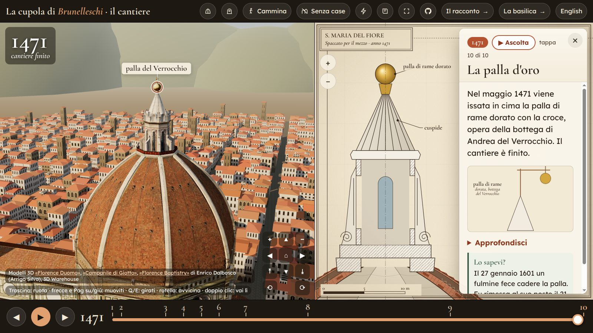
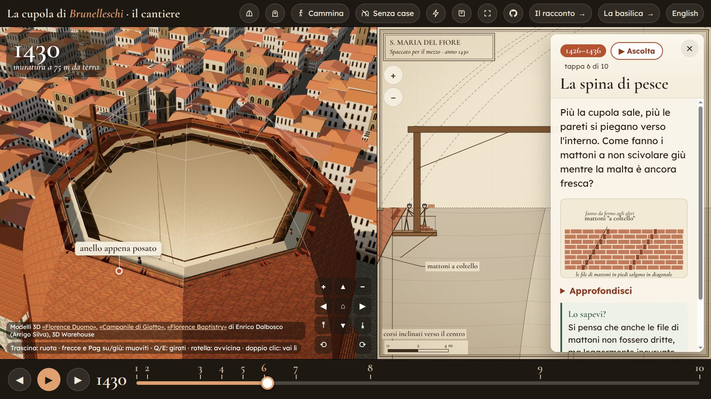
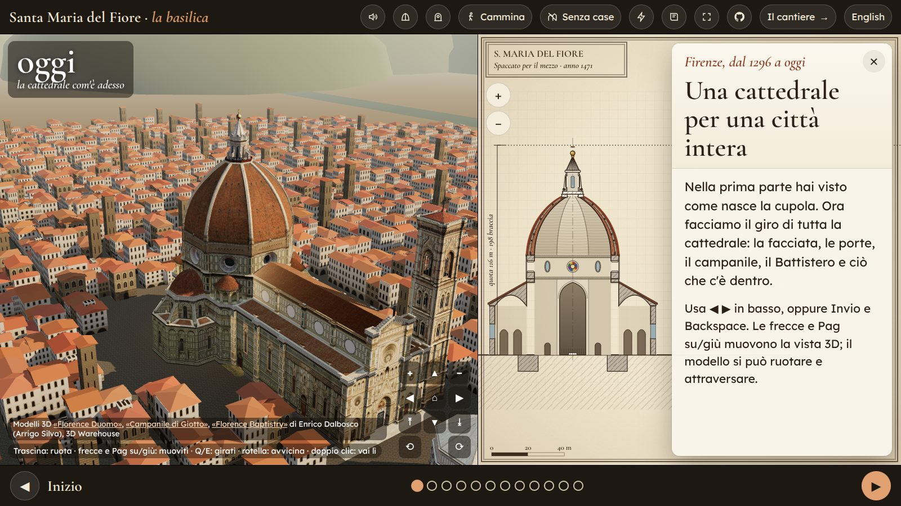
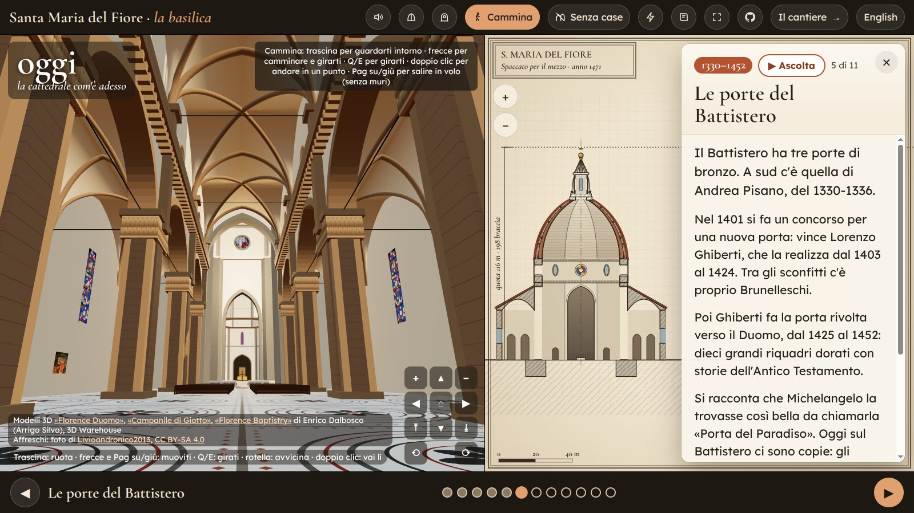
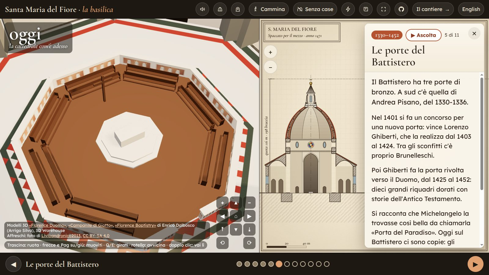
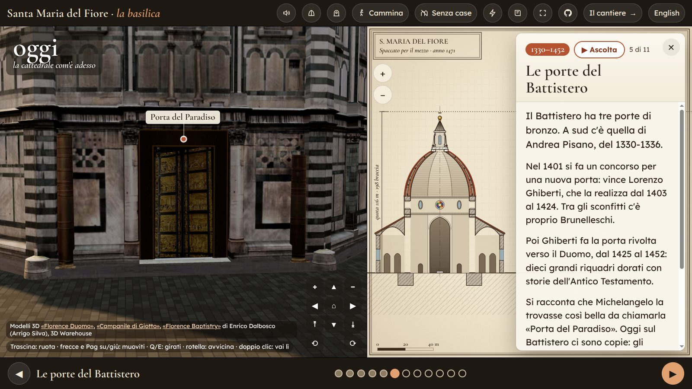
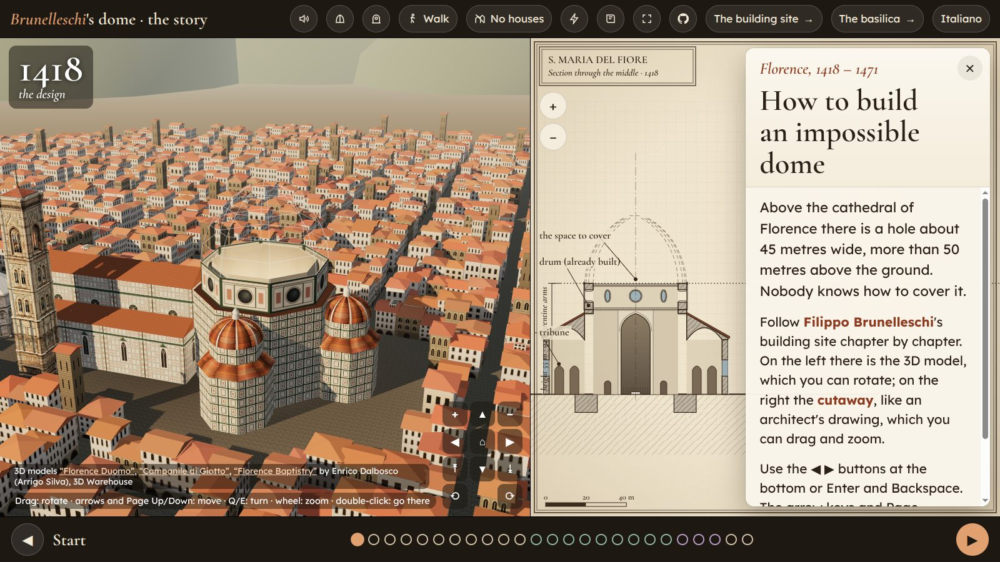

# La cupola di Brunelleschi · il Duomo di Firenze in 3D

**Provalo online: [icelordf.github.io/duomo-firenze-3d](https://icelordf.github.io/duomo-firenze-3d/)**

Tre percorsi interattivi su Santa Maria del Fiore, pensati per la seconda media. Si ruota il modello, lo si taglia per
guardare dentro la doppia calotta, si cammina nella navata. Ogni capitolo ha una voce narrante in italiano o in inglese.

| Percorso | Italiano | English |
| --- | --- | --- |
| **Il cantiere**: la cupola cresce anno per anno, dal 1418 al 1471 | [apri](https://icelordf.github.io/duomo-firenze-3d/dist/cupola-cantiere.html) | [open](https://icelordf.github.io/duomo-firenze-3d/dist/cupola-cantiere-en.html) |
| **Il racconto**: la sfida di Brunelleschi, curiosità e quiz | [apri](https://icelordf.github.io/duomo-firenze-3d/dist/cupola-racconto.html) | [open](https://icelordf.github.io/duomo-firenze-3d/dist/cupola-racconto-en.html) |
| **La basilica**: facciata, porte, Campanile, Battistero, interno | [apri](https://icelordf.github.io/duomo-firenze-3d/dist/cupola-basilica.html) | [open](https://icelordf.github.io/duomo-firenze-3d/dist/cupola-basilica-en.html) |



| | |
| --- | --- |
|  |  |
|  |  |
|  |  |

## Cosa c'è dentro

- **Il cantiere passo per passo.** Una linea del tempo porta la cupola dal tamburo vuoto del 1418 alla palla dorata del 1471. Si vedono le due calotte, gli speroni, i mattoni a spina di pesce, le catene di pietra e di legno, il bue-argano e la gru della lanterna.
- **Lo spaccato 2D.** Accanto al 3D c'è una sezione disegnata che segue lo stesso anno. C'è anche la tavola dei ponteggi interni, ricostruita sul disegno attribuito a Giovan Battista Nelli.
- **La piazza nel Quattrocento.** Duomo, Campanile e Battistero sono circondati da una città ricostruita sulla *Pianta della Catena* (c. 1470): case intonacate o in pietraforte, case-torri, sporti, tetti a padiglione, la Loggia del Bigallo. Con il tasto **C** le case spariscono.
- **L'interno da percorrere.** Entrando dal portale centrale si accende l'interno di oggi:
  - la navata, con pilastri in pietraforte, volte a crociera, catene, ballatoio, vetrate e banchi;
  - l'orologio di Paolo Uccello, il rosone e i monumenti equestri;
  - la crociera, con il coro ottagonale e il Giudizio universale di Vasari e Zuccari dentro la cupola.
- **Due lingue e la voce.** Tutti i testi e la narrazione esistono in italiano e in inglese.

### Comandi

| | |
| --- | --- |
| Trascina · rotella · doppio clic | ruota · avvicina · vai in quel punto |
| Frecce · Pag su/giù · Q/E | muoviti · sali e scendi · girati |
| **P** | «Cammina»: prima persona ad altezza d'occhio, con i muri (Esc per uscire) |
| **S** · **I** · **C** | taglia il modello · interno di oggi · nascondi le case |
| Invio / Backspace · Home / Fine | tappa o capitolo successivo / precedente · inizio / fine |
| **A** · **G** · **F** | ascolta · glossario · schermo intero |

## Com'è fatto

- **Nessun framework e nessun server.** Ogni pagina è un unico file HTML (circa 25 MB) che contiene librerie, font, immagini, modelli e audio. Si apre anche da chiavetta, senza rete. `build.mjs` (Node, senza dipendenze) assembla i sorgenti di `src/` nelle 6 pagine di `dist/`.
- **Il motore 3D** è [three.js](https://threejs.org/) r170, caricato come script classico, con `GLTFLoader` per i modelli.
  - **La cupola** è generata in codice, anno per anno: profilo a quinto acuto, otto vele, calotta interna ed esterna, speroni e catene. Un piano di taglio apre la sezione.
  - **Duomo, Campanile e Battistero** vengono dai modelli glb, alleggeriti con `scripts/slim-glb.py`. Al caricamento le mesh vengono fuse per materiale.
  - **Portali e Porta del Paradiso** sono foto raddrizzate, con un rilievo ricavato dalla luminanza (displacement e bump map).
  - **La città** usa `InstancedMesh` con tre tipi di facciata disegnati su canvas.
  - **Gli interni** sono costruiti in codice: crociere a sesto acuto calcolate come superficie, costoloni a tubo, pilastri compositi, coro ottagonale.
- **La modalità a piedi** usa le collisioni a raycast all'altezza del ginocchio e del petto: lungo i muri si scivola. Le ombre vengono ricalcolate solo quando cambia la scena.
- **Lo spaccato 2D** è un canvas disegnato in metri: tamburo, calotte, lanterna e la tavola dei ponteggi.
- **La narrazione** è generata con [ElevenLabs](https://elevenlabs.io/) (`scripts/tts.mjs`, modello eleven_v4) e incorporata come mp3.

### Struttura

```
src/        motore 3D (engine.js), spaccato 2D (section2d.js), contenuti (data.js, i18n-en.js), interfaccia, pagine
scripts/    slim-glb.py (alleggerisce i glb), tts.mjs (genera la voce)
vendor/     three.js, GLTFLoader, font, foto (img/ + credits.json), audio, originali scaricati (dl-*)
dist/       le 6 pagine pronte
docs/       screenshot
verifica/   confronti tra il modello e le foto reali
```

### Rifare la build

```bash
node build.mjs
```

I tre modelli `.glb` non sono nel repository: la loro licenza non permette di ridistribuirli come file a sé. Per rifare la build:

1. Scaricali da 3D Warehouse ([Florence Duomo](https://3dwarehouse.sketchup.com/model/8f187dc09654501c70f2373efbf66671/Florence-Duomo), [Campanile di Giotto](https://3dwarehouse.sketchup.com/model/a6bb0f9c555bbab490da2fe60070b981/Campanile-di-Giotto), [Florence Baptistry](https://3dwarehouse.sketchup.com/model/e0cebb9d97a2101d69a7efa28ad69d0e/Florence-Baptistry)) ed esportali in glb.
2. Passali a `scripts/slim-glb.py`.
3. Salvali come `vendor/model/{duomo,campanile,battistero}.glb`.

Per rigenerare la voce serve una chiave ElevenLabs in `.env.local`, che non va mai nel repository.

## Materiali e fonti

- **Modelli 3D** «Florence Duomo», «Campanile di Giotto» e «Florence Baptistry» di Enrico Dalbosco (Arrigo Silva), su [3D Warehouse](https://3dwarehouse.sketchup.com/).
- **Foto da Wikimedia Commons.** Autori, licenze e link di ogni immagine sono in [`vendor/img/credits.json`](vendor/img/credits.json) e nel glossario di ogni pagina. Tra le altre:
  - [facciata e Campanile](https://commons.wikimedia.org/wiki/File:Florence_Cathedral_Facade.jpg) di Cosmos1972;
  - [Porta del Paradiso](https://commons.wikimedia.org/wiki/File:Lorenzo_Ghiberti-The_Gates_of_Paradise_-_Original-Museo_dell%27Opera_del_Duomo_(Florence).jpg) di Yair Haklai;
  - [portale centrale](https://commons.wikimedia.org/wiki/File:Augusto_passaglia,_battenti_del_portale_centrale_della_facciata_del_duomo_di_firenze,_1889-1903,_01.jpg) di Sailko;
  - [Battistero](https://commons.wikimedia.org/wiki/File:Firenze_Battistero_di_San_Giovanni_Esterno_05.jpg) e [rosone](https://commons.wikimedia.org/wiki/File:Firenze_Cattedrale_di_Santa_Maria_del_Fiore_Interno_Navata_Contrafacciata_Finestra_2.jpg) di Zairon;
  - [Giudizio universale](https://commons.wikimedia.org/wiki/File:Dome_of_Cattedrale_di_Santa_Maria_del_Fiore_(Florence).jpg) di Livioandronico2013;
  - affreschi di Paolo Uccello e Andrea del Castagno;
  - vetrate di Ghiberti, Donatello e Paolo Uccello.
- **Ponteggi interni**: «Giovan Battista Nelli (attr.), ricostruzione dei ponteggi interni della cupola» (pubblico dominio, Wikimedia Commons).
- **La città nel 1470**: [Pianta della Catena](https://commons.wikimedia.org/wiki/File:Francesco_Rosselli_(attribution)._Pianta_della_Catena,_1470.jpg), attribuita a Francesco Rosselli (pubblico dominio).
- **Riferimenti storici**: [Cattedrale di Santa Maria del Fiore](https://it.wikipedia.org/wiki/Cattedrale_di_Santa_Maria_del_Fiore) e [Cupola del Brunelleschi](https://it.wikipedia.org/wiki/Cupola_del_Brunelleschi) su Wikipedia.
- **Librerie e font**: [three.js](https://github.com/mrdoob/three.js) (MIT), [Cormorant Garamond](https://fonts.google.com/specimen/Cormorant+Garamond) e [Lexend](https://fonts.google.com/specimen/Lexend) (SIL Open Font License).

## Licenze

- **Codice** (`src/`, `scripts/`, `build.mjs`, `index.html`): [MIT](LICENSE).
- **Foto**: ciascuna mantiene la propria licenza (pubblico dominio, CC BY, CC BY-SA), anche nelle versioni raddrizzate o ritagliate.
- **Modelli 3D**: *3D Warehouse General Model License*. Sono usati come parte di un'opera combinata, con i crediti sempre visibili nel modello; non vanno ridistribuiti da soli.
- **Voce narrante**: generata con ElevenLabs.

Progetto didattico, senza scopo di lucro. Segnalazioni e miglioramenti sono benvenuti nelle [issue](https://github.com/IcelordF/duomo-firenze-3d/issues).
